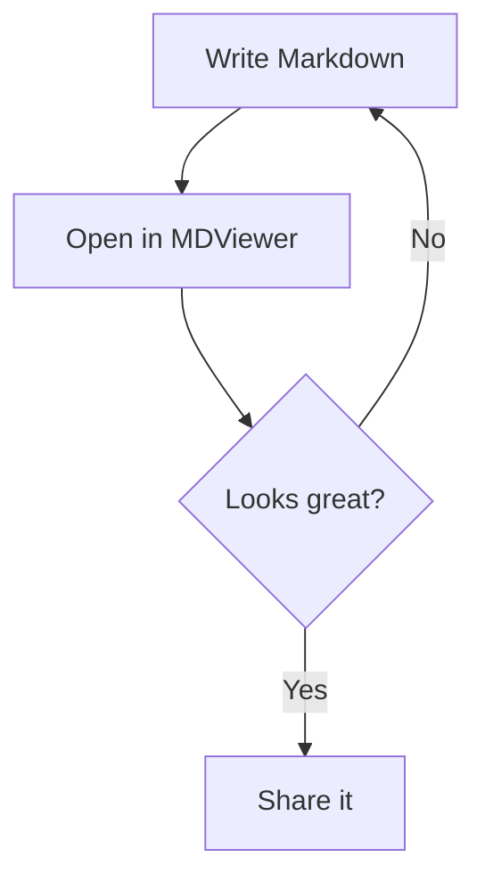
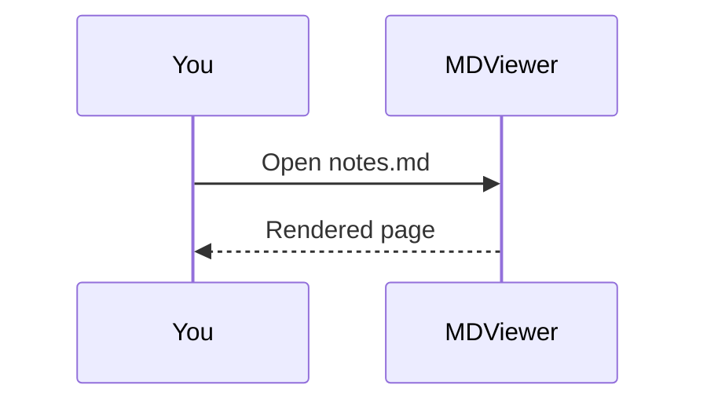

# Release Notes

MDViewer renders **Markdown** beautifully — with *syntax highlighting*, math, diagrams and tables, right on your iPhone.

## What's new

- [x] Fast, native rendering
- [x] Light and dark themes
- [ ] Your next great README

| Feature        | Status | Notes                  |
|----------------|:------:|------------------------|
| Code blocks    | ✅     | 40 languages via Shiki |
| Math           | ✅     | KaTeX, inline & block  |
| Diagrams       | ✅     | Mermaid                |
| Remote images  | 🔒     | Ask / Always / Never   |

> Private by design: no accounts, no tracking, no analytics.

## Code

```swift
struct Greeting {
    let name: String

    func render() -> String {
        "Hello, \(name)!"
    }
}
```

```python
def fibonacci(n):
    a, b = 0, 1
    for _ in range(n):
        yield a
        a, b = b, a + b

print(list(fibonacci(10)))
```

## Math

The quadratic formula: $x = \frac{-b \pm \sqrt{b^2 - 4ac}}{2a}$

$$
\int_{-\infty}^{\infty} e^{-x^2}\,dx = \sqrt{\pi}
$$

## Diagrams




