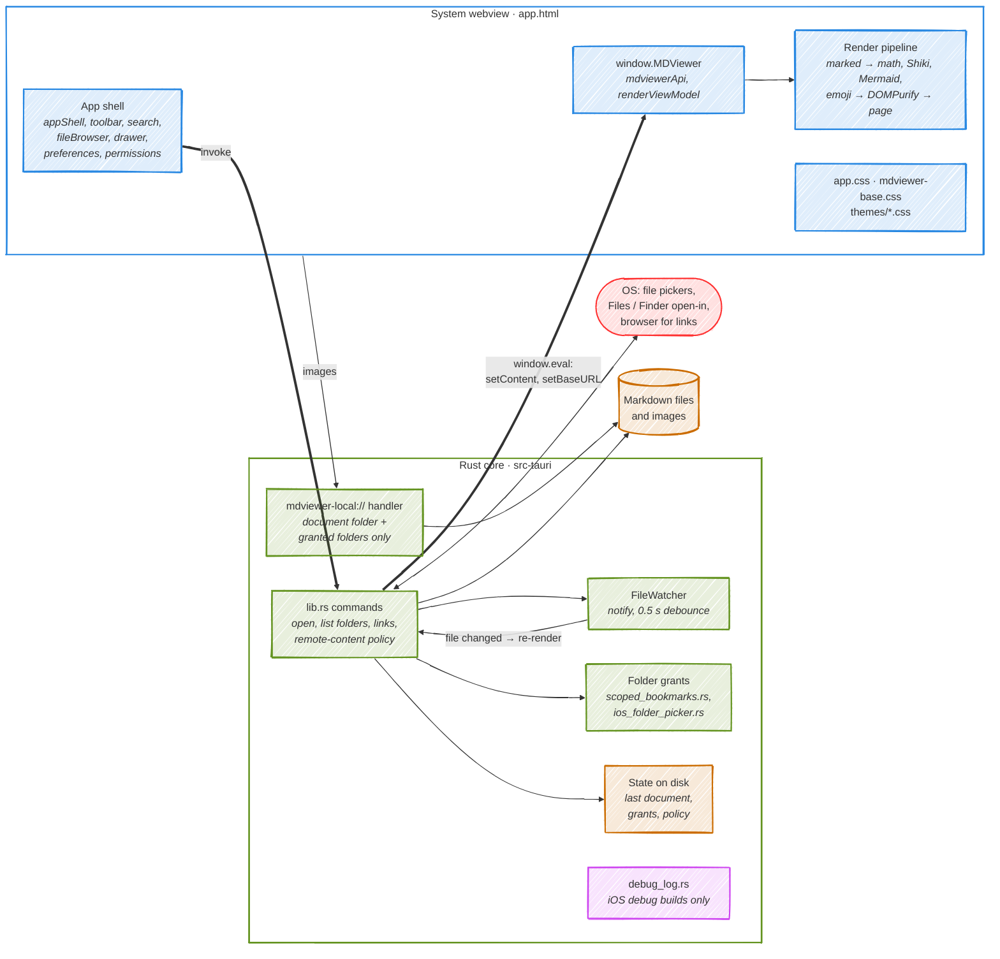
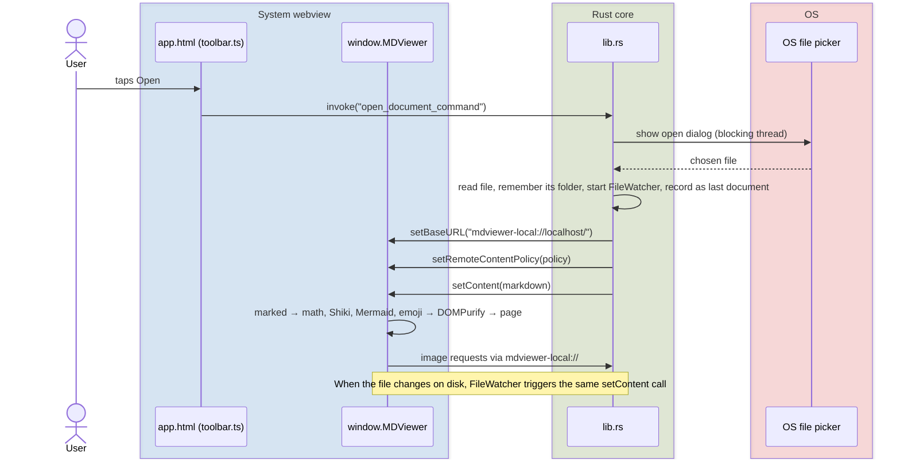
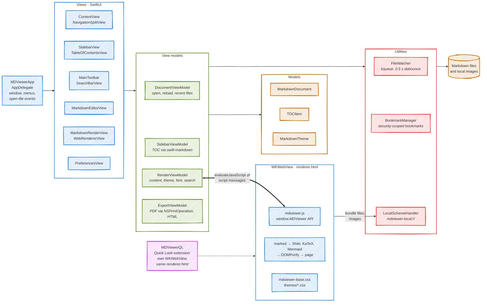

# MDViewer Architecture

MDViewer exists as two implementations that share one renderer:

| | **Tauri port** (current development) | **Swift app** (shipped reference) |
|---|---|---|
| Platforms | macOS, Windows, Linux, Android, iOS | macOS 14+ |
| Host | Tauri 2: Rust core + the OS's system webview | SwiftUI + WKWebView |
| UI | One web page (`app.html`) for chrome and document | SwiftUI chrome, WKWebView for the document |
| Renderer logic | TypeScript in `web/src`, bundled to `mdviewer.js` | The same `mdviewer.js` |
| Status | iPhone build on TestFlight (1.0.0); Android verified on the emulator; desktop runs via `tauri dev` | v1.2.x on the Mac App Store |

The Swift tree (`MDViewer/`) is the reference implementation and is not modified while the port is under way; see `docs/project/porting-brief.md` for the rules and `docs/project/plan.md` for progress. Both apps load the same `MDViewer/Resources/Web/` folder: the vendored libraries, `mdviewer-base.css`, the themes and the compiled `mdviewer.js`.

---

## Tauri port

### Overview



The whole interface (toolbar, file browser, Preferences, search and the document) is one web page, so the TypeScript modules call `window.MDViewer` as plain functions. Rust only does what needs the OS: files, pickers, folder permissions, file watching and opening links.

### Where the code lives

| Path | What it is |
|---|---|
| `src-tauri/src/lib.rs` | Tauri builder, commands, `mdviewer-local://` handler, file watcher, document state, desktop File menu |
| `src-tauri/src/scoped_bookmarks.rs` | Security-scoped bookmark FFI (macOS/iOS), vendored and audited |
| `src-tauri/src/ios_folder_picker.rs` | Native `UIDocumentPickerViewController` for folder grants on iOS |
| `src-tauri/src/debug_log.rs` | Writes `Documents/mdviewer-debug.log` in iOS debug builds (no USB needed) |
| `src-tauri/tauri.conf.json` | App ID, version, CSP, file associations, iOS build number |
| `web/src/*.ts` | Renderer and UI, compiled by esbuild to `MDViewer/Resources/Web/mdviewer.js`. Never edit that output file by hand. |
| `MDViewer/Resources/Web/app.html`, `app.css` | The port's page and its UI styles (`renderer.html` is the Swift app's page) |
| `MDViewer/Resources/Web/vendor/`, `themes/` | Pinned libraries and theme stylesheets, shared with the Swift app |
| `web/test/` | Unit tests (vitest + jsdom) |
| `web/visual/` | Contrast and layout audit in real WebKit (Playwright) |

The `web/src` modules, grouped:
- **Rendering**, ported from the Swift app's `mdviewer.js`:
  - `mdviewerApi`, `markedRenderer`, `highlightCode`, `math`, `mermaid`, `emoji`;
  - `sanitize`, `remote`, `localResources`, `interactionListeners`, `dom`.
- **View models**, ported from Swift: `renderViewModel`, `markdownTheme`.
- **Interface:**
  - `appShell`, `toolbar`, `toolbarAutoHide`, `search`, `preferences`;
  - `aboutPanel`, `fileBrowser`, `drawer`, `permissions`.
- **Plumbing:**
  - `main` is the entry point and wires everything together;
  - `errorForwarding` passes script errors to the iOS debug log;
  - `index` re-exports the rendering modules.

### Bridge

| Direction | Mechanism | Calls |
|---|---|---|
| Page → Rust | `invoke` (`@tauri-apps/api`) | `open_document_command`, `list_directory`, `request_folder_access`, `list_granted_folders`, `handle_link_click`, `get_remote_content_policy`, `set_remote_content_policy`, `set_remote_content_policy_always`, `log_frontend_error` |
| Rust → page | `window.eval` of a `window.MDViewer` call, with the Markdown escaped by `escape_for_js` (ported from Swift) | `setContent`, `setBaseURL`, `setRemoteContentPolicy` |
| Page → Rust (files) | `mdviewer-local://localhost/<path>` requests | images relative to the document, served only from its folder or a granted folder |

### Opening a document



Documents opened from Finder or the Files app ("Open in MDViewer") arrive as Tauri's `RunEvent::Opened` and take the same rendering path. The last document is reopened at launch.

### Differences from the Swift app

Deliberate, or not ported yet. `plan.md` tracks each one.
- **No table-of-contents sidebar.** It was dropped in favour of the file browser, a slide-in drawer listing the open document's folder and granted folders.
- **No editor mode, no PDF/HTML export and no print.** `ExportViewModel` isn't ported, and PDF export on Windows, Linux and Android is still an open question.
- **New: a first-launch permissions prompt** (`permissions.ts`), and an **About** tab in Preferences with the third-party notices.
- **The desktop File menu** (Open, Save, Save As) exists only on desktop. On every platform the toolbar's Open button calls `open_document_command`.

---

## Swift app (reference implementation)



Thin arrows show which layer uses which. The heavy arrow is the Swift ↔ JavaScript bridge: `RenderViewModel` calls into `window.MDViewer`, and the page answers with script messages that `WebRendererView` receives. The renderer never loads `file://` URLs. Everything, bundled libraries included, comes through `LocalSchemeHandler`, which serves images only from the open document's folder.

### Components

| Layer | Component | Role |
|---|---|---|
| App | `MDViewerApp`, `AppDelegate` | `WindowGroup` + `Settings` scenes, menus and keyboard commands, the About panel's credits, files opened from Finder |
| Views | `ContentView` | `NavigationSplitView` root; owns the four view models; switches between viewer and editor |
| | `SidebarView`, `TableOfContentsView` | Heading outline; selecting a heading scrolls the renderer |
| | `MainToolbar`, `SearchBarView` | Open, editor toggle, export, theme and font size; find in page |
| | `MarkdownEditorView` | Plain-text editor beside the live preview |
| | `MarkdownRenderView`, `WebRendererView` | Hosts the WKWebView, registers the URL scheme and script-message handlers |
| | `PreferencesView` (+ General, Appearance) | Settings window |
| View models | `DocumentViewModel` | Open panel, file reading, `FileWatcher`, bookmarks, recent files |
| | `SidebarViewModel` | Builds `TOCItem`s from the Markdown with `swift-markdown` |
| | `RenderViewModel` | Pushes content, theme, font size, base URL and remote-content policy into the page |
| | `ExportViewModel` | PDF through `NSPrintOperation` (save-as-PDF via the print system), HTML from the page's `outerHTML` |
| Models | `MarkdownDocument`, `TOCItem`, `MarkdownTheme` | Document, heading and theme values |
| Utilities | `FileWatcher` | `DispatchSource` kqueue watcher, 0.5 s debounce |
| | `BookmarkManager` | Security-scoped bookmarks for files and granted folders |
| | `HTMLBuilder` | Locates the bundled `Web/` resources |
| | `LocalSchemeHandler` | `WKURLSchemeHandler` for `mdviewer-local://`; path-checked against the bundle and the document's folder |
| Extension | `MDViewerQL` | Quick Look preview with its own WKWebView, `renderer.html` and scheme handler; remote content always off |

### Bridge

Swift → JavaScript, via `evaluateJavaScript` with the string escaped by `escapeForJS`:

```swift
MDViewer.setContent('…')                    // Markdown source
MDViewer.setTheme('github-dark')            // theme CSS file name
MDViewer.setFontSize(16)
MDViewer.setBaseURL('mdviewer-local://localhost/')
MDViewer.setRemoteContentPolicy('ask')      // ask | always | never
MDViewer.scrollToAnchor('section-1')
```

JavaScript → Swift, via `WKScriptMessageHandler`. The message names are `headingsExtracted`, `renderComplete`, `scrollPositionChanged`, `linkHovered`, `linkClicked` and `remoteContentBlocked`:

```javascript
window.webkit.messageHandlers.linkClicked.postMessage(href);
```

`linkClicked` opens local `.md` links in the app and `http`/`https`/`mailto` links in the default handler. `remoteContentBlocked` triggers the "Load remote content?" prompt.

### Source layout

```
MDViewer/
├── App/            MDViewerApp.swift, AppDelegate.swift
├── Models/         MarkdownDocument, TOCItem, MarkdownTheme
├── ViewModels/     Document, Sidebar, Render, Export view models
├── Views/
│   ├── ContentView.swift
│   ├── Sidebar/    SidebarView, TableOfContentsView
│   ├── Renderer/   MarkdownRenderView, WebRendererView, MarkdownEditorView, LocalSchemeHandler
│   ├── Toolbar/    MainToolbar, SearchBarView
│   └── Preferences/ PreferencesView, GeneralPrefsView, AppearancePrefsView
├── Utilities/      FileWatcher, BookmarkManager, HTMLBuilder
├── MDViewerQL/     PreviewViewController (Quick Look extension)
└── Resources/Web/  shared with the port (see below)
MDViewerTests/      XCTest suite
```

---

## Shared renderer resources

```
MDViewer/Resources/Web/
├── renderer.html        Swift app's page
├── app.html, app.css    Tauri port's page and UI styles
├── mdviewer.js          compiled from web/src (do not edit)
├── mdviewer-base.css    document layout
├── vendor/              marked, shiki.bundle.js, katex (+ fonts/), mermaid, dompurify
└── themes/              github-light, github-dark, solarized-light, solarized-dark, dracula, nord
```

Pinned library versions and their hashes are in `docs/project/supply-chain.md`. Each theme defines the shared colour tokens described in [Colour & contrast](color-and-contrast.md).

## Security

These invariants date from Swift 1.2.0 and are carried into the port:

| Invariant | Swift app | Tauri port |
|---|---|---|
| Renderer served over a custom scheme, never `file://` | `mdviewer-local://` | Tauri's own protocol + `mdviewer-local://` |
| Strict Content Security Policy | In `renderer.html` | `app.security.csp` in `tauri.conf.json` |
| All rendered Markdown passes through DOMPurify | ✓ | ✓ (`sanitize.ts`) |
| Links limited to `http`, `https`, `mailto` and local `.md` | ✓ | ✓ (`handle_link_click`) |
| Remote images gated by Ask / Always / Never | ✓ | **Gap:** the CSP blocks all remote images, so "Always" has no effect |
| Local images per-folder and explicit, never whole-disk | Sandbox + bookmarks | Path checks in Rust; **gap:** no desktop sandbox entitlements yet |

---

See also:
- [Setup](setup.md): building and testing both apps
- [Contributing](contributing.md): workflow and conventions
- [Colour & contrast](color-and-contrast.md): theme rules and the visual audit
- [Design plan](design-plan.md): the original 2026-05 plan for the Swift app, kept for history
