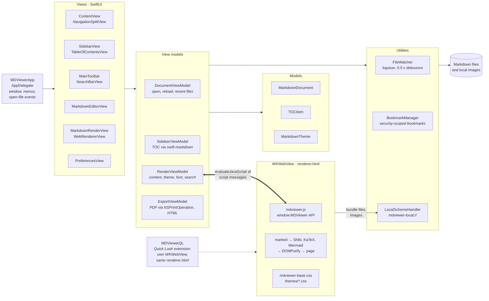

# MDViewer Architecture

This document describes the technical architecture of MDViewer at a high level.

## System Overview

MDViewer is a native macOS Markdown viewer built with SwiftUI and WKWebView, following the MVVM (Model-View-ViewModel) pattern. SwiftUI draws the window chrome (sidebar, toolbar, editor, Preferences); a WKWebView renders the document itself, using bundled JavaScript libraries.



Thin arrows show which layer uses which. The heavy arrow is the Swift ↔ JavaScript bridge (details below): `RenderViewModel` calls into `window.MDViewer`, and the page answers with script messages that `WebRendererView` receives. The renderer never loads `file://` URLs: everything, bundled libraries included, comes through `LocalSchemeHandler`, which serves images only from the open document's own folder.

## Core Components

### SwiftUI Views

**ContentView**
- Root container using `NavigationSplitView`
- Manages layout: sidebar on left, detail on right
- Coordinates state between sidebar and renderer

**SidebarView & TableOfContentsView**
- Displays hierarchical heading structure (H1–H4)
- Built with nested `List` + `DisclosureGroup`
- Scrolls renderer when items are clicked

**MarkdownRenderView**
- Container for the WKWebView renderer
- Manages export, PDF generation
- Handles search interactions

**WebRendererView**
- `NSViewRepresentable` wrapper around WKWebView
- Loads local HTML template
- Manages message bridge (Swift ↔ JS)

**EditorView (when ⌘E is pressed)**
- Split-pane editor on the left
- Live preview on the right
- Syntax highlighting during editing

### View Models

**DocumentViewModel**
- Manages the current file URL and content
- File watching via `DispatchSourceFileSystemObject`
- Recent files list

**SidebarViewModel**
- Extracts heading hierarchy from Markdown
- Uses `swift-markdown` (swiftlang) AST parser
- Updates when document content changes

**RenderViewModel**
- Manages HTML content for rendering
- Theme selection and application
- Font size state
- Search state

**ExportViewModel**
- PDF export via `WKWebView.createPDF()`
- HTML export with inline CSS
- Handles `NSSavePanel` for file selection

### Models

**MarkdownDocument**
- Implements `FileDocument` protocol
- Handles file I/O and encoding
- Manages unsaved changes indicator

**TOCItem**
- Represents a heading in the table of contents
- Properties: id, level (1–4), title, anchor
- Hierarchical relationships stored implicitly

**MarkdownTheme**
- Represents a theme (name, CSS file path)
- Provides theme list and current selection

## Communication: Swift ↔ JavaScript

### Swift → JavaScript

Uses `WKWebView.evaluateJavaScript()`:

```swift
MDViewer.setContent(markdown: "# Hello")        // Set content
MDViewer.setTheme(name: "github-dark")          // Change theme
MDViewer.setFontSize(size: 14)                  // Adjust font
MDViewer.scrollToAnchor(id: "section-1")        // Jump to heading
```

### JavaScript → Swift

Uses `WKScriptMessageHandler`:

```javascript
webkit.messageHandlers.mdviewer.postMessage({
  action: "headingsExtracted",
  headings: [...]
});
```

Handled by `WebRendererView.userContentController(_:didReceive:)`.

## File Structure

### Resources (Bundled)

```
MDViewer/Resources/
├── Web/
│   ├── renderer.html              ← Main template
│   ├── mdviewer.js                ← JS bridge + marked setup
│   ├── mdviewer-base.css          ← Layout CSS
│   ├── vendor/
│   │   ├── marked.min.js
│   │   ├── shiki.min.js
│   │   ├── katex.min.js
│   │   ├── katex.min.css
│   │   ├── mermaid.min.js
│   │   ├── dompurify.min.js
│   │   └── highlight-default.min.css
│   └── themes/
│       ├── github-light.css
│       ├── github-dark.css
│       ├── solarized-light.css
│       ├── solarized-dark.css
│       ├── dracula.css
│       └── nord.css
└── Assets.xcassets/
    └── AppIcon.appiconset/
```

### Source Code

```
MDViewer/
├── App/
│   ├── MDViewerApp.swift          ← @main entry point
│   └── AppDelegate.swift          ← Menu bar setup
├── Models/
│   ├── MarkdownDocument.swift
│   ├── TOCItem.swift
│   └── MarkdownTheme.swift
├── ViewModels/
│   ├── DocumentViewModel.swift
│   ├── SidebarViewModel.swift
│   ├── RenderViewModel.swift
│   └── ExportViewModel.swift
├── Views/
│   ├── ContentView.swift
│   ├── Sidebar/
│   │   ├── SidebarView.swift
│   │   └── TableOfContentsView.swift
│   ├── Renderer/
│   │   ├── MarkdownRenderView.swift
│   │   ├── WebRendererView.swift
│   │   └── LocalSchemeHandler.swift
│   ├── Editor/
│   │   ├── EditorView.swift
│   │   └── SplitEditorView.swift
│   ├── Toolbar/
│   │   ├── MainToolbar.swift
│   │   └── SearchBarView.swift
│   └── Preferences/
│       ├── PreferencesView.swift
│       ├── AppearancePrefsView.swift
│       └── GeneralPrefsView.swift
├── Utilities/
│   ├── FileWatcher.swift          ← DispatchSource kqueue
│   ├── BookmarkManager.swift      ← Security-scoped URLs
│   └── HTMLBuilder.swift          ← Template assembly
└── Entitlements.plist
```

## Data Flow

### Opening a File

1. User clicks File > Open or drags a file
2. `DocumentViewModel` loads file content via `MarkdownDocument`
3. Content is passed to `SidebarViewModel` for heading extraction
4. Headings are displayed in sidebar
5. Content is passed to `RenderViewModel` for HTML conversion
6. `WebRendererView` receives HTML and injects into WKWebView

### Clicking a TOC Item

1. User clicks heading in `TableOfContentsView`
2. `SidebarViewModel.scrollToHeading()` is called
3. This invokes `RenderViewModel.scrollToAnchor(id:)`
4. Swift calls `MDViewer.scrollToAnchor(id)` via JavaScript
5. JS finds the heading element and scrolls into view

### File Change Detection

1. `DocumentViewModel.startWatching()` sets up `DispatchSourceFileSystemObject`
2. File system event detected
3. 0.5-second debounce applied (to avoid duplicate events)
4. File re-read and content updated
5. Views automatically refresh via `@Published` properties

## Security Considerations

- **No network in WKWebView**: All resources are bundled locally
- **Content sanitization**: User Markdown is parsed by marked.js, then rendered as HTML
- **Local file access**: Restricted via `BookmarkManager` and `LocalSchemeHandler`
- **Sandbox**: Entitlements configured for file access (if enabled)

## Performance Optimizations

- **Debounced file watching**: 0.5-second delay prevents excessive reloads
- **Lazy heading extraction**: TOC is built on-demand
- **Bundled resources**: No network requests; everything is local
- **Swift markdown caching**: AST is rebuilt only when content changes

## Future Extensibility

The architecture supports:
- **Additional themes**: Drop new CSS files in `Resources/Web/themes/`
- **Custom renderers**: Modify `mdviewer.js` to add marked.js extensions
- **Language support**: Add i18n via Localization Catalog
- **Plugin system**: Could expose JavaScript bridge for extensions

---

See also:
- [Design Plan](design-plan.md) — Architecture rationale and decisions
- [Setup Guide](setup.md) — Development environment setup
