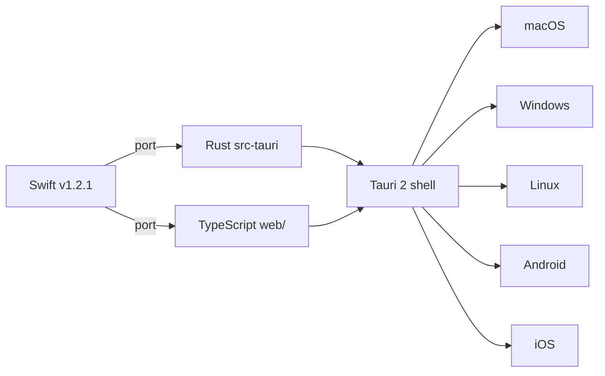

# MDViewer Demo :rocket:

A tour of everything the renderer is supposed to handle: `marked`, KaTeX,
Shiki, Mermaid, DOMPurify, and the emoji shortcode layer — all through the
**hand-written `mdviewer.js`**, the current authoritative renderer.

## Text formatting

Plain text, **bold**, _italic_, ***bold italic***, ~~strikethrough~~, and
`inline code`. A [link to an https URL](https://example.com) and a
`mailto:` link: <mailto:demo@example.com>.

> A blockquote, because documentation always needs one.
>
> — Someone, probably

## Lists

- Unordered item one
- Unordered item two
  - Nested item
    - Deeper nested item

1. Ordered item one
2. Ordered item two
   1. Nested ordered item

- [x] Task done
- [ ] Task not done

## Table

| Library   | Pinned version | Purpose            |
|-----------|-----------------|---------------------|
| marked    | 18.0.6          | Markdown parsing    |
| Shiki     | 4.3.1           | Code highlighting   |
| KaTeX     | 0.17.0          | Math rendering      |
| Mermaid   | 11.17.2         | Diagrams            |
| DOMPurify | 3.4.15          | Sanitization        |

## Code

Inline: `const x: number = 42;`

```typescript
interface TOCItem {
  level: number;
  title: string;
  anchor: string;
}

function slugify(title: string): string {
  return title.toLowerCase().replace(/[^a-z0-9]+/g, "-");
}
```

```rust
fn folder_covers(folder: &Path, dir: &Path) -> bool {
    dir.starts_with(folder)
}
```

```bash
adb push document.md /data/local/tmp/mdviewer_test_document.md
```

## Math

Inline math: the debounce window is $500\text{ms} = 0.5\text{s}$.

Block math, the quadratic formula:

$$
x = \frac{-b \pm \sqrt{b^2 - 4ac}}{2a}
$$

## Diagram



## Emoji

Shortcodes: :grinning: :rocket: :sparkles: :fire: :thumbs_up: :tada:-ish
via `confetti_ball`: :confetti_ball:

## Sanitization check

Raw HTML in the source should be stripped by DOMPurify:
<script>document.title = "XSS";</script> — if you can read this sentence
and the tab title is unchanged, sanitization is working.

---

*End of demo document.*
