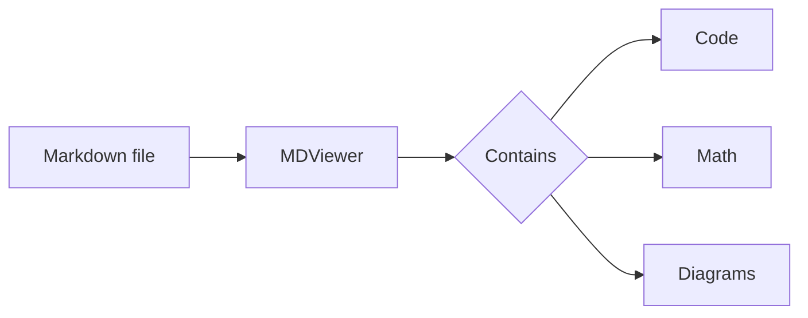
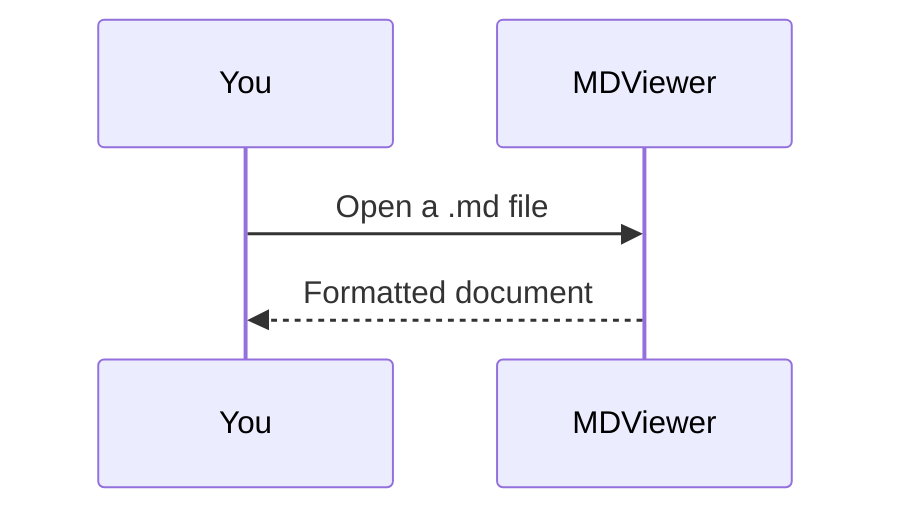

# Welcome to MDViewer :hand_wave:

MDViewer shows Markdown files the way they're meant to look. This sample
document is built into the app, so you can try every feature without a file
of your own. To open your own documents, tap **Open…** in the toolbar, or
open a `.md` file from the Files app with *Share → MDViewer*.


## Text formatting

Markdown supports **bold**, *italic*, ~~strikethrough~~, `inline code` and
[links](https://www.markdownguide.org). Emoji shortcodes turn into emoji:
:rocket: :sparkles: :coffee:

> Blockquotes are useful for notes and quotations.
>
> They can span several paragraphs.

## Lists

1. Numbered lists
2. Nested lists
   - with bullet points
   - at any depth
3. And task lists:

- [x] Open a Markdown document
- [x] Read it with syntax highlighting, math and diagrams
- [ ] Try another theme in Preferences → Appearance

## Tables

| Feature             | Supported | Notes                       |
|---------------------|:---------:|-----------------------------|
| Syntax highlighting |    Yes    | Swift, Python, Rust, …      |
| Math (KaTeX)        |    Yes    | Inline and display formulas |
| Mermaid diagrams    |    Yes    | Flowcharts, sequences, more |
| Themes              |    Yes    | Light and dark              |

## Code

```swift
struct Greeting {
    let name: String

    func message() -> String {
        "Hello, \(name)!"
    }
}
```

```python
def fibonacci(n: int) -> list[int]:
    numbers = [0, 1]
    while len(numbers) < n:
        numbers.append(numbers[-1] + numbers[-2])
    return numbers[:n]
```

## Math

Inline math sits in a sentence: the area of a circle is $A = \pi r^2$.

Display math gets its own line:

$$
\int_{-\infty}^{\infty} e^{-x^2} \, dx = \sqrt{\pi}
$$

## Diagrams





## Find and preferences

- **Find** (magnifying glass, top right) searches the document.
- **Preferences** (gear, top right) has the theme and font size under
  *Appearance*, the remote-image setting under *Privacy*, and the
  open-source licenses under *About*.
- **Browse files** (top left) lists the Markdown files in a folder you've
  given MDViewer access to.

---

MDViewer is open source under the MIT License. No account, no tracking.
